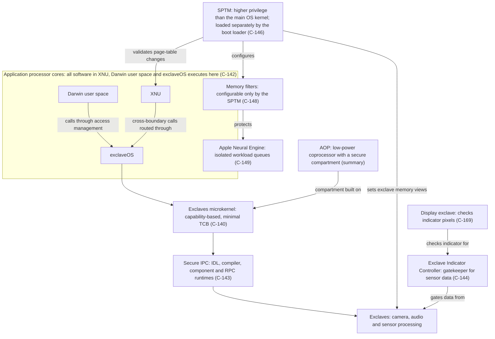

# Secure Exclaves architecture map (v0.5.0)

**Status:** a map of the components and relationships stated by Apple's Secure Exclaves article (S-058) and the other cited sources. Relations are drawn only where a source states them. Nothing here is verified on any device. Readiness: **LEVEL 0 / NO-GO**, unchanged.

## 1. Diagram

**Not drawn:** the Secure Enclave Processor (SEP). The article names SEP and uses its queues as a model, but it does not state SEP's relationship to the other components or its processor class. Apple's Platform Security guide describes the Secure Enclave firmware, sepOS, as "based on an Apple-customised version of the L4 microkernel" (C-152). That is a statement about sepOS, not an edge in this map.

## 2. The questions the map answers

| Question | Answer from the sources | Basis |
|---|---|---|
| Which components are separate processors? | AOP is named as a low-power coprocessor. SEP, the Neural Engine and the display exclave are not described as processors in the article | S-058 (see [terminology](../research/apple-security-terminology.md)) |
| Which components run on application-processor cores? | XNU, Darwin user space and exclaveOS | C-142 |
| Which components have independent execution contexts? | Exclaves run in a different processor execution context from the main OS (summary). The SPTM runs at a higher privilege level than the main OS kernel | S-058 (C-146) |
| Which components manage memory permissions? | The SPTM: page-table policy, typed physical pages, exclave memory views and memory filters. The exclaves microkernel: capabilities that set each exclave's memory permissions | C-145, C-147, C-148; summary for the microkernel |
| Which components manage communication? | Secure IPC: explicit capabilities, no default communication. RPC calls routed through XNU to exclaveOS (summary). The AOP compartment communicates with exclaves through the microkernel | C-143; summary |
| Which components provide hardware isolation? | Memory filters, per-context permission views enforced by Apple silicon hardware (summary), the display-subsystem hardware block that checks pixels (C-169), and the isolated Neural Engine queues protected by memory filters (C-149) | S-058 |
| Which component gates sensor data? | The Exclave Indicator Controller, which releases data only after the indicator check (C-144) | S-058 |

## 3. What the map does not show

- SEP's relationship to the other components and its processor class.
- The processor class of the Neural Engine and of the display exclave.
- Which products contain which components. The article names products only for indicator and feature statements (C-139). See the [applicability assessment](a17pro-exclave-applicability.md).
- The device-level layout of any device profiled here. No device evidence is recorded.

## 4. Related records

- Architecture summary: [Apple Secure Exclaves architecture](../research/apple-secure-exclaves-architecture.md).
- Manifest comparison: [exclave manifest reconciliation](../research/exclave-manifest-reconciliation.md).
- Component matrix: [Apple silicon security matrix](apple-silicon-security-matrix.md).
